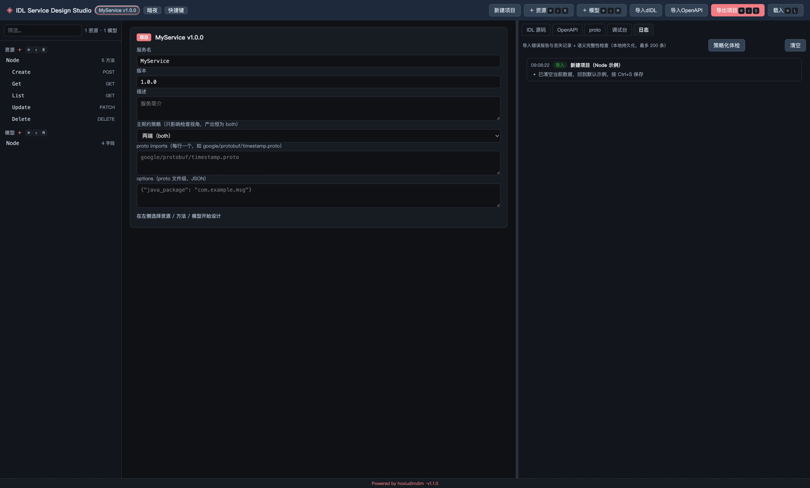

# IDL Service Design Studio

**内部 IDL 可视化设计台**：用表单设计一份与输出格式无关的中立 IDL 契约，实时「编译」生成
**OpenAPI 3.1（REST）** 与 **protobuf / gRPC（RPC）** 两套契约，并内置 **mock 调试台**。

可设计各个状态下的预期返回示例数据,方便前端按照预期对接;

实时编译符合openAPI规范的yaml或符合GRPC规范的poto,方法支持添加注释;

产物AI友好,方便无基础用户设计完毕直接交付给AI进行编程减少沟通成本;

支持导入 OpenAPI 3.x 反解续写，以及导出 / 导入 `.didl` 跨设备还原继续编辑。

轻量、零构建、纯浏览器交互（仅服务端做本地持久化）。自带浅色 / 暗夜双主题。



## 使用场景

- **契约优先 / API 先行**：开发前先用表单敲定 API 契约（接口、字段、状态码、预期返回），前后端据此各自实现，减少沟通与返工
- **前端先行对接**：无需等后端，直接为各状态设计预期返回示例，前端按示例先联调
- **交付 AI 编程**：设计完一键导出 OpenAPI / proto 契约，作为输入直接交给 AI 生成代码，降低沟通成本
- **既有 API 迁移续写**：已有 OpenAPI 3.x 项目，导入反解回 IDL 表单继续编辑、扩展新接口
- **双形态覆盖**：一份 IDL 同时编译出 REST（OpenAPI 3.1）与 RPC（protobuf/gRPC），一套定义覆盖多种客户端
- **跨设备协作**：把全部 IDL + 备注导出为 `.didl`，换设备 / 环境导入即还原继续编辑
- **契约沉淀与评审**：设计结果作为契约文档沉淀、供团队评审与归档

## 特性

**契约设计**
- **表单设计**：资源 / 方法 / 模型树；字段类型 `string · int · number · bool · timestamp · enum · array · ref · map`，位置 `body · path · query · header`，必填 / 枚举 / 描述一应俱全
- **双向同步**：表单改动实时回写 YAML 源码并重算两套预览；也可直接手写 YAML 源码，停顿自动解析回填表单
- **备注与预期示例**：方法级备注说明（作为文档与编程智能体提示词：OpenAPI 并入 `description`、proto 全级注释，另保留 `x-note` 无损副本）与预期正常返回示例（→ 200 `example`，调试台直接使用）

**双生成器（一份 IDL → 两套契约）**
- **OpenAPI 3.1**：schemas / `$ref` / enum / `date-time` / 数组 / map / 内联输出，200 响应可带 `example`
- **protobuf / gRPC**：`proto3`、`package`、每资源一个 `XxxService`、`<Res><Method>Request`、枚举、`Timestamp` / `Empty`
- 方法 / 字段 / 模型 / 资源的描述（`desc`）与备注（`note`）以注释形式进入 OpenAPI `description` 与 proto 全级注释，作为交付 AI 的提示词通道

**语义完整性检查（1.1.0）**
- **产出恒 both + 按产物自动检查**：复制 / 导出 / 导入 / 体检时，按当前「主契约策略」视角做语义 lint，补齐两端的注释与描述缺口
- **主契约策略**（`rest` / `rpc` / `both`，默认 `both`）：随 `.didl` 携带，决定右面板默认标签与体检汇总视角；策略只影响检查视角，不改变产出（始终 both）
- **分级提醒**：warn 级缺失 → 弹窗中断二选一「先查看日志 / 依旧复制」；info 或通过 → 无中断，提示显示在「新建项目」左侧

**导入续写**
- **导入 OpenAPI**：粘贴或选文件导入 OpenAPI 3.x（yaml / json），反解回 IDL 表单继续编辑
- **导出项目 / 导入 DIDL**：把全部 IDL + 备注打包为 `.didl` 导出，跨设备 / 环境导入还原继续编辑

**proto 无损属性**
- `tag` 字段编号（自动避让 `reserved` 紧凑补号）、`imports` 项目级依赖、`reserved` 编号 / 名称区间
- `oneof` 互斥字段组 + 方法流类型 `none / server / client / bidi`
- `options` 兜底袋：项目 / 模型 / 字段 / 方法四层 JSON 录入，proto 原样回写

**项目与调试**
- **项目信息**：服务名 / 版本 / 描述 / imports / 主契约策略，标题栏项目名胶囊随时管理
- **新建项目**：一键清空回默认示例
- **mock 调试台**：选方法 → 示例参数 → 选错误码或 200 → 模拟响应；响应支持查找（正则、上一个 / 下一个、高亮）
- **日志标签页**：集中展示导入错误报告、丢失记录与语义完整性检查结果（本地持久化，可清空）

**运行**
- 持久化到本地 `project.json`；`Ctrl/Cmd + S` 快速保存
- 轻量、零构建、纯浏览器交互（仅服务端做本地持久化），浅色 / 暗夜双主题

## 快速开始

需要 Node.js ≥ 16。**无需 `npm install`** —— 浏览器端 js-yaml 已 vendor 进 `public/vendor/`，克隆后直接运行：

```bash
npm start
```

> 仅当你需要修改依赖（如升级 js-yaml）时才执行 `npm install`。
> 打开 <http://127.0.0.1:8010>。

> 端口：默认 `8010`，被占用时可用 `PORT=8011 npm start` 换端口。
> 服务仅绑定 `127.0.0.1`，不对外网开放。

**Docker 运行（容器化，适合 NAS / 服务器）**

```bash
docker run -d --name idlstudio -p 8010:8010 \
  -v idlstudio-data:/app/data \
  --restart unless-stopped \
  ghcr.io/raysico/idlstudio:latest
```

- 基底镜像 `node:20-alpine`；数据挂载命名卷 `/app/data`（保存的 `project.json` 存于命名卷，升级不丢）。
- 亦可改用 `HOST=0.0.0.0` 暴露到局域网（默认仅 `127.0.0.1`）。
- 完整 compose 编排与 NAS 部署说明见 [`IDLstudioDockercompose`](https://github.com/raysico/IDLstudioDockercompose)。

## 用法

1. 左侧树选中 **资源 / 方法 / 模型**，中间表单编辑；
2. 右侧五个标签页实时查看 **IDL 源码 / OpenAPI / proto / 调试台 / 日志**；
3. 顶部可 **导入OpenAPI** 续写、「**导入dIDL / 导出项目**」跨设备迁移、「**新建项目**」一键清空；
4. 顶部「保存」或 `Ctrl/Cmd+S` 持久化到 `project.json`。

IDL 语法与 OpenAPI / proto 的完整映射规则见 **[DESIGN.md](DESIGN.md)**。

## 项目结构

```
IDLstudio/
├── server.js          # 本地服务：静态页 + /api/project 持久化 + 提供浏览器版 js-yaml
├── package.json       # 唯一依赖 js-yaml；版本号单一源（页脚 vX 由它提供）
├── DESIGN.md          # 设计文档（IDL 语法 + 双生成映射 + 语义检查 + 调试台 + 限制）
├── README.md          # 使用说明
├── CHANGELOG.md       # 更新记录
├── ROADMAP.md         # 更无损设计目标路线图
├── 提交规范.md         # 发布前提交规则（含 project.json 重置示例数据）
├── Dockerfile         # 容器化：node:20-alpine + 命名卷 /app/data
├── .dockerignore
├── .github/workflows/ # CI：check.yml + publish-image.yml（打 v* tag → GHCR 多架构）
├── project.json       # 示例项目（可修改；保存时更新）
├── LICENSE
└── public/
    ├── index.html
    ├── style.css      # 浅/暗双主题
    ├── app.js         # IDL 模型、表单、双向同步、双生成器、语义检查、调试台、查找、快捷键
    └── importer.js    # OpenAPI 3.x → IDL 导入器
```

## 工作原理

服务端只做静态托管与项目持久化；**IDL → OpenAPI / proto 的编译全部在浏览器端完成**（`app.js` + 浏览器版 `js-yaml`），因此无需任何后端编译依赖。

## 示例

`project.json` 自带一个 `MyService / Node` 示例：启动后即可在树中看到 `Node` 资源的增删改查方法，右侧实时生成对应 OpenAPI 与 proto。

## 许可证

[MIT](LICENSE) © 2026 何小点点 (hoxiudimdim)
